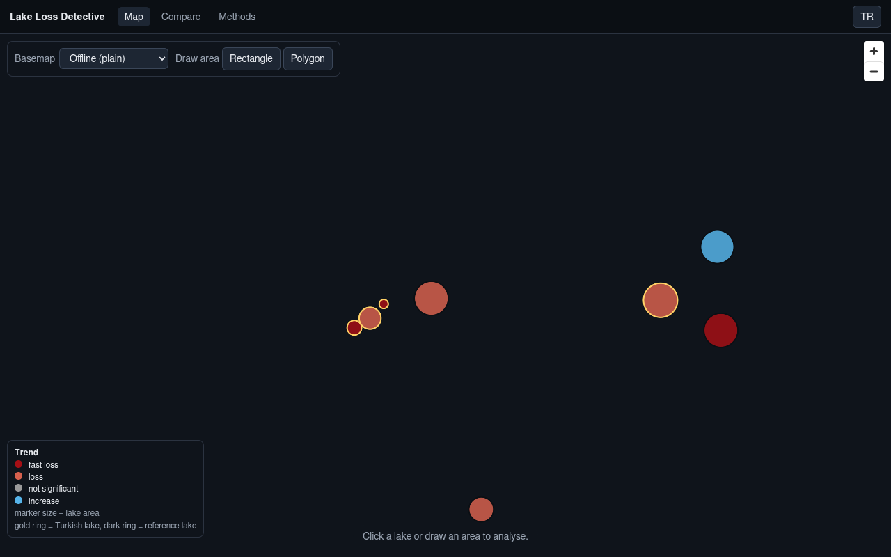
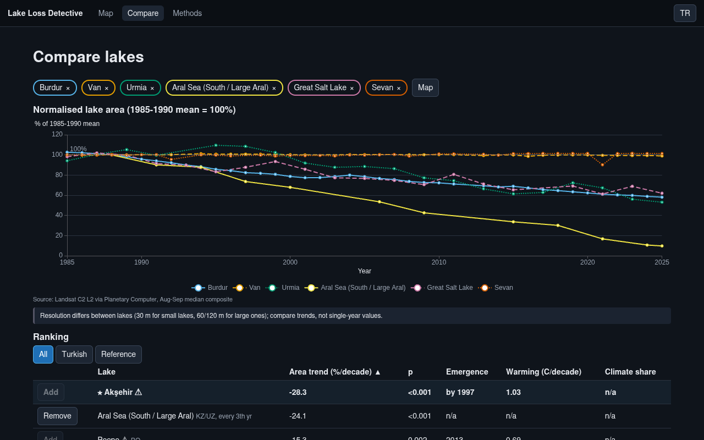
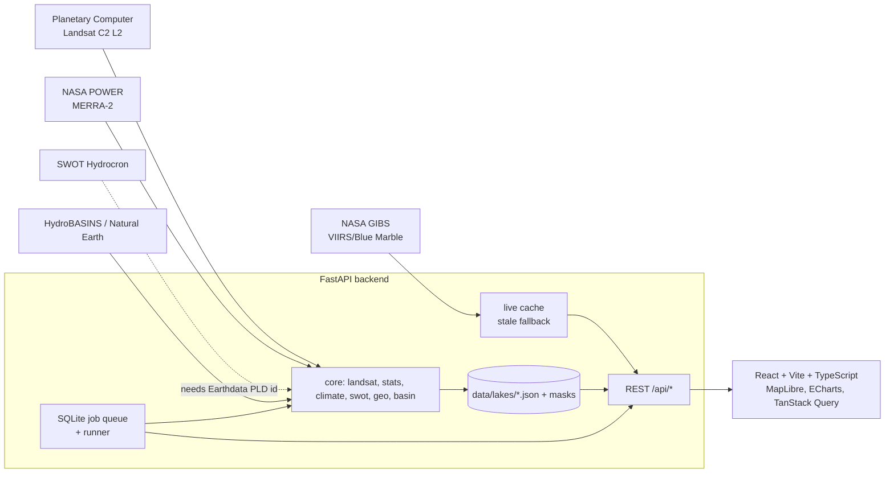

# Lake Loss Detective

**Is this lake shrinking, since when, and is it the climate or something else?**
A NASA Space Apps Challenge 2026 project (challenge: "Become An Earth Trend Detective!"). Team: **Augmented 6th**.

Pick a lake on the map (or draw a rectangle/polygon around any lake up to 20,000 km2). The app measures its water area
and surface temperature from 40 years of Landsat, tests the trend, estimates the year the loss becomes distinguishable
from natural variability, and compares the loss with what NASA POWER (MERRA-2) precipitation minus evaporation would
predict. The part that climate does not explain is a **sign, not proof**, of human impact.





(Screenshots were taken at the end of Stage 6; Stage 7 added the offline basemap, sample-job button and lazy loading
but did not change the main layouts. They were not regenerated in Stage 8.)

## What is in it
- 4 Turkish lakes with full 1985-2025 records (Burdur, Akşehir, Eğirdir, Van) and 13 global reference lakes (Urmia, Aral
  South/North, Great Salt Lake, Lake Mead, Lake Chad, Poopó, Titicaca, Balkhash, Sevan, Tuz, Qinghai, Dead Sea).
  Aral is split into South/North at about 46.1 N (approximate).
- On-demand analysis of any new lake (Natural Earth lake index or a drawn polygon), run as a background job with
  progress, labelled **unverified**.
- Live cards: latest Landsat scene, NASA POWER precipitation vs normal, NASA GIBS VIIRS picture, SWOT (see limitations).
- Compare page: normalised area change (% of the 1985-1990 mean), ranking, scatter, resolution note. TR/EN interface.
- Offline demo mode: committed cache snapshot, local country-border basemap, pre-computed sample job (Sevan).

## Install
Requirements: Python 3.12 (uv recommended), Node 20+.
```bash
uv venv --python 3.12 .venv && uv pip install -p .venv/bin/python -r requirements-dev.txt   # runtime only: requirements.txt
cd frontend && npm ci && cd ..
```
HydroBASINS (about 360 MB) is downloaded once into `data/raw/` (gitignored) when a precompute needs it.
The committed `data/` already holds all 17 precomputed lake records, so the app runs without recomputing.

## Run
Development (two terminals):
```bash
.venv/bin/uvicorn backend.api.main:app --port 8000 --reload
cd frontend && npm run dev          # Vite proxies /api to :8000
```
Single port (demo):
```bash
cd frontend && npm run build && cd ..           # -> frontend/dist
.venv/bin/uvicorn backend.api.main:app --port 8000   # API + UI on http://127.0.0.1:8000 (/compare, /methods)
```
Docker: `docker compose up` serves the same single port 8000 with `./data` mounted.
**Docker was NOT verified**: the build machine has no Docker. Try it once online before relying on it.

### Deploy on Render
**The Render deploy was NOT verified by us** (no Docker here, no Render account used). `render.yaml` follows the Render Blueprint spec.
1. Render dashboard: New -> Blueprint -> select this repo (reads `render.yaml`: Docker web service, free plan, Frankfurt, health check `/api/health`, auto-deploy on commits to `main`).
   Or New -> Web Service -> Docker, same repo, branch `main`, health check path `/api/health`, and add env var `LLD_BASIN_FALLBACK=1`.
2. The container listens on Render's `$PORT` (default 8000 locally). No secrets are needed.

Free-tier caveats:
- Sleeps after about 15 min idle; the first request then has a cold start (up to a minute).
- 512 MB RAM. `LLD_BASIN_FALLBACK=1` (set in `render.yaml`) makes new-lake analysis use the 50 km buffer basin instead of downloading the 360 MB HydroBASINS (flagged `fallback` in the result). Analysis of new lakes can still be slow or run out of memory.
- Ephemeral disk: custom analyses, the job database and the live cache are lost on restart/redeploy. Precomputed lakes, the index and the demo cache are in the image. The live cache is re-seeded from `data/demo_cache`; live cards refresh on demand, and `backend.scripts.prefetch --demo` locally then committing `data/demo_cache` refreshes the shipped snapshot.
- For persistence, a paid plan with a disk mounted at `/app/data/custom` would keep custom analyses (not configured here).

### Before a demo (needs internet, once)
```bash
.venv/bin/python -m backend.scripts.prefetch --demo     # live cards + VIIRS pictures -> data/live_cache -> data/demo_cache
```
`prefetch` exits 1 on any failure (SWOT only warns). Known gaps: Landsat "now" cards for Balkhash and Aral South
and SWOT for every lake show "no data". Check offline behaviour with `LLD_OFFLINE=1 .venv/bin/uvicorn backend.api.main:app`
(blocks every non-loopback socket). Do not restart the server while an analysis job runs: running jobs fail on restart (by design).

### Tests
`tools/run_tests.sh` is the single command: pytest (offline, synthetic data and mocked responses; RuntimeWarning is an
error), TypeScript typecheck, Vitest, then Playwright e2e when a Chromium is found (`SKIP_E2E=1` skips e2e).

## Architecture

Precomputed records live in `data/lakes/<alias>/` (`series.json`, `climate.json`, `swot.json`, `meta.json`, yearly masks).
On-demand lakes go to `data/custom/`. Live results are cached in `data/live_cache/` and seeded from `data/demo_cache/`.
Summaries in the UI are filled from templates, so every number comes from the data files.

## Data sources
| Source | Use | Citation / link |
|---|---|---|
| Landsat 4-5 TM Collection 2 Level-2 (USGS), via Microsoft Planetary Computer STAC | water area (MNDWI), surface temperature, 1985-2012 | doi:10.5066/P9IAXOVV (verified via DataCite); https://planetarycomputer.microsoft.com |
| Landsat 8-9 OLI/TIRS Collection 2 Level-2 (USGS), via Planetary Computer | same, 2013-2025 | doi:10.5066/P9OGBGM6 (verified via DataCite) |
| NASA POWER (MERRA-2 based) monthly point API, PRECTOTCORR and EVLAND | precipitation minus evaporation proxy, "% of normal" live card | https://power.larc.nasa.gov (no DOI found) |
| MERRA-2 tavg1_2d_lnd_Nx (GMAO), underlying reanalysis | model data, not station data | doi:10.5067/RKPHT8KC1Y1T (verified); Gelaro et al. 2017, J. Climate, doi:10.1175/JCLI-D-16-0758.1 (verified) |
| SWOT via PO.DAAC Hydrocron (Prior Lake Database) | lake volume change code | https://podaac.github.io/hydrocron/ ; product DOI NOT VERIFIED. Not used for results (needs Earthdata login for the lake id). |
| NASA GIBS (VIIRS true colour daily, Blue Marble) | map imagery and live picture | https://earthdata.nasa.gov/gibs (no DOI) |
| HydroBASINS (HydroSHEDS) | catchment for the P-E analysis | Lehner & Grill 2013, Hydrol. Process., doi:10.1002/hyp.9740 (verified) |
| Natural Earth 10m lakes, countries | lake index, offline basemap | https://www.naturalearthdata.com (public domain, no DOI) |
| OpenFreeMap | online vector basemap (no token) | https://openfreemap.org |

## Method
- **Water area**: MNDWI = (green - SWIR1) / (green + SWIR1) > 0 (Xu 2006, doi:10.1080/01431160600589179, verified), cloud/shadow/saturation
  masked with QA_PIXEL and QA_RADSAT, per-pixel median composite of all scenes (cloud < 40 %) in 1 Aug-30 Sep of each
  year, restricted to the connected lake component of an auto-detected polygon (+1 km). Pixel size adapts to lake area
  (30/60/120/240 m); UTM zone is chosen automatically.
- **Surface temperature (LST)**: Landsat Level-2 ST band over eroded pure-water pixels.
- **Trend**: Hamed-Rao modified Mann-Kendall (Hamed & Rao 1998, doi:10.1016/S0022-1694(97)00125-X, verified) with Sen's slope (Sen 1968,
  doi:10.1080/01621459.1968.10480934, verified) on actual years. Significance p < 0.05; p always shown.
- **Emergence year**: first year after which the Sen line stays more than 2 sigma from the reference mean (first 12
  valid years, detrended sigma). A year equal to the first post-reference year is flagged "censored" and read as "by that year".
- **Climate decomposition**: area change between observed years is regressed on n_years and sum(P-E) over 1985-1999;
  predicted climate-driven loss afterwards vs observed loss gives the explained share, with a 2000-draw bootstrap 90 % CI.
  Interpretation flags mark weak skill, shares outside 0-1 and CIs including 0.
- **SWOT volume**: area-level fit and dV = integral of A dh with an extrapolation flag; unit-tested on synthetic data only.

## Validation
Details in [VALIDATION.md](VALIDATION.md).
- **Burdur vs Sabuncu et al. 2020** (doi:10.35414/akufemubid.711653, verified): 1986 ours 204.8 km2 vs 206 (-0.6 %); 2019 ours 127.8 km2 (Stage 1 box mask) vs 125 (+2.2 %). Ours is an Aug-Sep composite, theirs June/July single scenes.
  Burdur trend: Sen -21.1 km2/decade, p = 3.3e-6.
- **Reference lakes**: the direction of change was compared with the literature direction. Agreement for Urmia, Aral South,
  Great Salt Lake, Lake Mead, Dead Sea, Poopó, Tuz; inconclusive for Aral North and Qinghai (no significant trend); not tested
  for Chad, Balkhash, Sevan (literature mixed); Titicaca's "stable" expectation is unverified and our series declines (-2.85 %/decade).
  Some literature directions rest on abstracts or news; see VALIDATION.md.
- Only Burdur is quantitatively validated. The "validated" badge means: Turkish lake, or reference lake whose direction matches the literature, and not low reliability.

## Limitations
- **Sensor break**: Landsat 5 to 8 (no data in 2012) causes a thermal step of about 2.9 C for Burdur; pooled LST trends are not clean warming rates. Pre-2013 and post-2013 trends are reported separately and the sensors are not cross-calibrated.
- **EVLAND is a land evapotranspiration proxy**, not open-water evaporation. POWER and MERRA-2 are model data, not stations.
- The P-E decomposition is **not computable** where the 1985-1999 reference has no skill (Burdur, Van) and for Akşehir (unreliable series). Eğirdir's share is not distinguishable from 0.
- **Low reliability**: Akşehir (volatile shallow water, 10 of 39 years flagged), Poopó and Tuz (flagged low reliability; see VALIDATION.md for the reasons). Their trends and emergence years are not reliable.
- **Chad** area is an MNDWI lower bound (vegetated shallows are missed). Aral South at 240 m and Balkhash/Urmia at 120 m are coarse; large lakes use every 2nd/3rd year. Compare uses normalised percentages for that reason.
- Early Landsat 5 coverage is sparse outside Europe/North America; some lakes start late or have under 10 valid years (no trend then).
- **SWOT is unavailable** without an Earthdata login (Prior Lake Database id lookup); the volume code is not verified on real data and SWOT is too short (since 2023) for long-term trends.
- **A residual after climate is a sign, not proof, of human impact.** Results for transboundary lakes (Aral, Chad, Dead Sea, Titicaca) are data-only statements.
- On-demand lakes are unverified. Docker, mobile layout and real Hydrocron data were not verified.

## Team
Augmented 6th (NASA Space Apps Challenge 2026). Members: _to be filled in by the team_.

## License
No LICENSE file yet (to be chosen by the team). Data licences belong to their providers.
