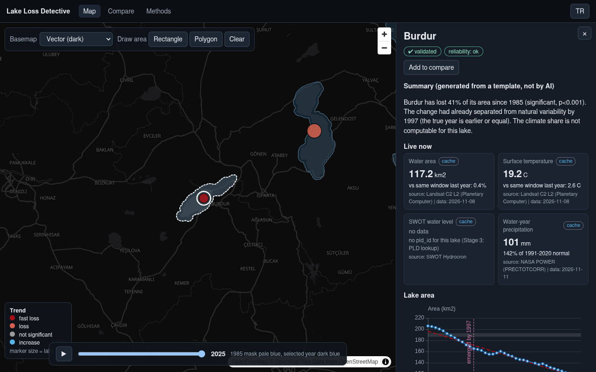

# Lake Loss Detective (NASA Space Apps 2026)

Work in progress. Original prototype in legacy/; task spec in docs/PROMPT-v2.md.

## Backend (Stage 2)
- `backend/core/` landsat, stats, climate, swot, live, geo (auto UTM, adaptive resolution, lake component), basin (HydroBASINS), lakes (definitions).
- `backend/api/main.py` minimal FastAPI app (`/api/health`, `/docs`): `.venv/bin/uvicorn backend.api.main:app`.
- Precompute a lake record: `.venv/bin/python -m backend.scripts.precompute --lake burdur` (writes `data/lakes/<alias>/`; aliases burdur, aksehir, egirdir, van; the alias maps to the `lake_id` stored in `meta.json`).
- Tests (offline): `tools/run_tests.sh`. HydroBASINS (~360 MB) is downloaded once to `data/raw/` (gitignored).

## Stage 3 outputs
`data/lakes/<alias>/climate.json` (NASA POWER P-E decomposition, bootstrap 90 % CI), `swot.json` (ok=false unless a PLD id is set), `series.json` stats incl. `area_emergence` / `lst_emergence`. Refresh with `.venv/bin/python -m backend.scripts.analyze <alias...>` (POWER cached in `data/power_cache/`).
**The part of the loss that climate (P-E) does not explain is a sign, not proof, of human impact.** EVLAND is a land evapotranspiration proxy, not open-water evaporation; check `interpretation_flags` before quoting a share.

## Frontend (Stage 5)

React + Vite + TypeScript (strict), MapLibre GL, ECharts, TanStack Query, TR/EN (default EN). One port for the demo:

```bash
cd frontend && npm ci && npm run build      # -> frontend/dist (not committed)
cd .. && .venv/bin/uvicorn backend.api.main:app --port 8000     # API + UI on http://127.0.0.1:8000 (/compare, /methods too)
```

Dev: `npm run dev` (Vite proxies /api to :8000). API types: `npm run gen:api` (OpenAPI -> `src/api/schema.d.ts`, committed).
Tests: `tools/run_tests.sh` (pytest + typecheck + Vitest + Playwright e2e when Chromium is available; `SKIP_E2E=1` to skip).



