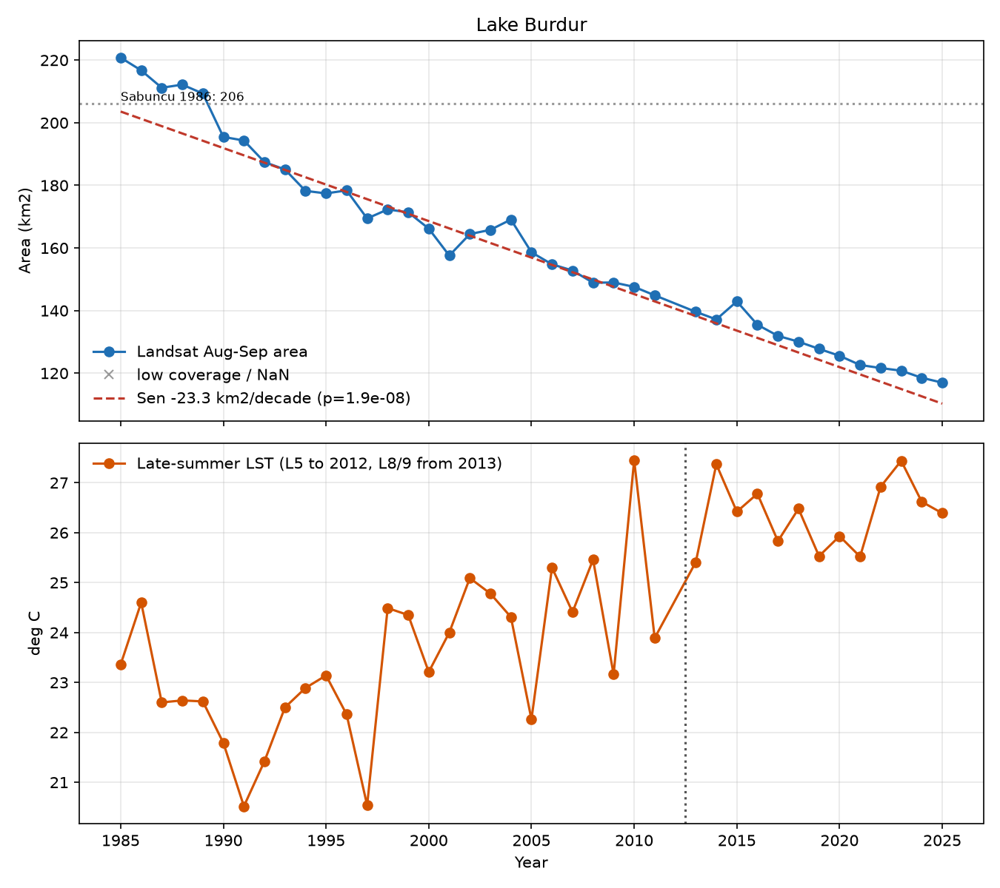

# Stage 1 validation: Lake Burdur (real Planetary Computer data)

Run date 2026-11-14. Module: `burdur_area.py` (fixed working copy; `legacy/` untouched). Series: `data/lakes/burdur/series.json`, plot: `docs/burdur_series.png`.
Reproduce: `.venv/bin/python burdur_area.py --start 1985 --end 2025 --out data/lakes/burdur/series.json --plot docs/burdur_series.png` (about 10 min). Offline tests: `tools/run_tests.sh`.

## 1. Assumptions 1-2 (verified by `tools/verify_assets.py` on real items)
- L5 items (LT05_L2SP_178034_19860924, LT05_L2SP_179034_20100901): thermal asset `lwir`; no `lwir11`.
- L8 (LC08_L2SP_178034_20210924) and L9 (LC09_L2SP_179034_20230929): thermal asset `lwir11`; no `lwir`.
- NIR key is `nir08` (`nir` does not exist). The code does not use NIR (MNDWI = green, swir16).
- `raster:bands`: thermal scale 0.00341802, offset 149, nodata 0, unit kelvin; green/swir16/nir08 scale 2.75e-05, offset -0.2, nodata 0; `qa_pixel` nodata 1. All match the code constants.
- odc-stac returns raw DN (no scaling), so scaling stays in code. Landsat 4 and 7 are excluded (platform filter `in [landsat-5, landsat-8, landsat-9]` works server side, plus a client-side guard).
- Legacy fixes: bbox east edge (below), explicit platform guard, retries (2) + GDAL HTTP timeout, dask workers limited to 4, years run sequentially, failed year kept as NaN with `error` field, pure-numpy `analyze_arrays` for offline testing, JSON output.

## 2. Comparison with literature
Sabuncu 2020 (doi 10.35414/akufemubid.711653): 206 km2 (20 Jun 1986), 125 km2 (8 Jul 2019), June/July single scenes with MLC/SVM/MNDWI. Ours is the Aug-Sep median of all scenes with cloud cover < 40 %, so ours is later in the dry season (lake lower by evaporation) and uses a composite.

| Year | Ours (km2) | Reference | Difference |
|---|---|---|---|
| 1986 | 216.7 | 206 (Sabuncu) | +5.2 % |
| 2019 | 127.8 | 125 (Sabuncu) | +2.2 % |
| 2020 | 125.6 | ~120-125 target | within / +0.5 % of 125 |
| 2021 | 122.6 | ~120-125 | within |
| 2022 | 121.6 | ~120-125 | within |

All inside the 10 % acceptance limit. The 120 km2 for 2022 comes from a repository listing of Kaya et al. 2023, not verified against the full text.

### Cause of the first-run failure (173 km2 in 1986, -16 %)
The first box (lon 29.95-30.30) clipped the lake: `tools/diagnose_component.py` (largest connected water component around 30.18E 37.72N in a wide box, MNDWI > 0) found the 1986 lake spanning lon 30.056-30.389, lat 37.645-37.848, 204.8 km2, while in 2020 it spans lon 30.061-30.270 (124.8 km2). The 2020 result was unaffected (125.0 km2 in the first run), which is why 2020 alone looked fine. Box changed to lon 29.95-30.45, lat 37.60-37.90. Yarisli Lake (37.56N 29.96E) stays outside because lat_min is 37.60.
Threshold sensitivity (same diagnostic, lake component, 1986): MNDWI > 0: 204.8; > -0.1: 205.9; > -0.2: 208.1 km2. In 2020: 124.8 / 127.1 / 150.1 (at -0.2 the lake merges with neighbouring wet ground). So threshold 0 is kept.
Remaining difference: the box total in 1986 (216.7) is about 12 km2 above the connected lake component (204.8). Likely other water or wet pixels inside the box (not verified which); Stage 2's "largest connected component + buffer" polygon should remove this. Older years (1985, 1987-1989: 209-221 km2) are therefore a few percent high.
Caveat: 1989 to 1990 shows a drop of 14 km2 and 2002-2004 a rise (164-169 km2), both inside the noise of 2-8 scenes per year; not investigated.

## 3. Lake surface temperature
Late-summer median of eroded (150 m) water pixels: 20.5-27.5 deg C in all years (min 20.52 in 1991, max 27.45 in 2010), inside the expected 20-28 range (the range itself is not literature-verified; Aslan and Koc-San 2021 absolute values were not checked). Pure-water pixel counts are large; no year dropped for lack of pixels.

## 4. Trend tests (Hamed-Rao modified Mann-Kendall + Sen slope, years with valid_frac >= 0.8)
- Area 1985-2025: decreasing, n=40 (1985-2025), Sen -23.33/decade, p=1.91e-08 km2.
- LST all years: increasing, n=40 (1985-2025), Sen +1.28/decade, p=1.01e-07 deg C.
- **L5 to L8 break (2012/2013)**: LST before: increasing, n=27 (1985-2011), Sen +1.02/decade, p=0.00862 deg C; after: no trend, n=13 (2013-2025), Sen +0.21/decade, p=0.669 deg C. The step in level is visible (mean 1985-2011 about 23.5, 2013-2025 about 26.3). Part of the 1985-2025 warming may be an L5/L8 calibration offset rather than a lake change, so the pooled trend (+1.28 deg C/decade) must not be presented as a clean warming rate. The within-L5 trend (+1.0 deg C/decade) is significant; the L8/9-only trend is not. No cross-calibration was attempted. L8/9 (100 m TIRS, resampled) versus L5 (120 m) also differ in resolution and shrinking lake shifts which pixels remain pure water.
- 2012 is NaN: Landsat 5 stopped in 2011 and Landsat 8 began in 2013; Landsat 7 is excluded by design. Error field empty (genuinely no scenes: n_scenes = 0).
- No year failed with a network error (all `error` fields null).

## 5. Per-year table (Aug-Sep composite; valid_frac in series.json)
| Year | Area km2 | LST deg C | Scenes |
|---|---|---|---|
| 1985 | 220.8 | 23.36 | 7 |
| 1986 | 216.7 | 24.60 | 4 |
| 1987 | 211.2 | 22.60 | 8 |
| 1988 | 212.2 | 22.64 | 8 |
| 1989 | 209.3 | 22.62 | 6 |
| 1990 | 195.5 | 21.79 | 8 |
| 1991 | 194.3 | 20.52 | 8 |
| 1992 | 187.4 | 21.42 | 6 |
| 1993 | 185.1 | 22.50 | 8 |
| 1994 | 178.2 | 22.89 | 8 |
| 1995 | 177.4 | 23.14 | 7 |
| 1996 | 178.4 | 22.36 | 8 |
| 1997 | 169.4 | 20.54 | 7 |
| 1998 | 172.3 | 24.49 | 6 |
| 1999 | 171.4 | 24.35 | 7 |
| 2000 | 166.2 | 23.21 | 8 |
| 2001 | 157.6 | 24.00 | 7 |
| 2002 | 164.4 | 25.09 | 2 |
| 2003 | 165.8 | 24.78 | 6 |
| 2004 | 169.1 | 24.31 | 6 |
| 2005 | 158.6 | 22.26 | 3 |
| 2006 | 154.8 | 25.30 | 5 |
| 2007 | 152.8 | 24.41 | 4 |
| 2008 | 148.9 | 25.46 | 5 |
| 2009 | 149.0 | 23.16 | 7 |
| 2010 | 147.6 | 27.45 | 4 |
| 2011 | 144.9 | 23.89 | 4 |
| 2012 | NaN | NaN | 0 |
| 2013 | 139.6 | 25.41 | 8 |
| 2014 | 137.2 | 27.37 | 7 |
| 2015 | 142.9 | 26.42 | 7 |
| 2016 | 135.5 | 26.78 | 7 |
| 2017 | 131.9 | 25.83 | 8 |
| 2018 | 130.1 | 26.48 | 7 |
| 2019 | 127.8 | 25.53 | 8 |
| 2020 | 125.6 | 25.93 | 8 |
| 2021 | 122.6 | 25.52 | 6 |
| 2022 | 121.6 | 26.92 | 9 |
| 2023 | 120.8 | 27.44 | 14 |
| 2024 | 118.5 | 26.62 | 13 |
| 2025 | 117.0 | 26.39 | 16 |

## 6. Not verified / open
- Cause of the ~12 km2 excess in the box total versus the connected lake in 1986-89.
- Absolute LST values against literature; absolute accuracy of the thermal data.
- Mixed-sensor consistency of area (L5 vs L8 MNDWI) beyond the 2011/2013 continuity (144.9 to 139.6 km2, consistent).
